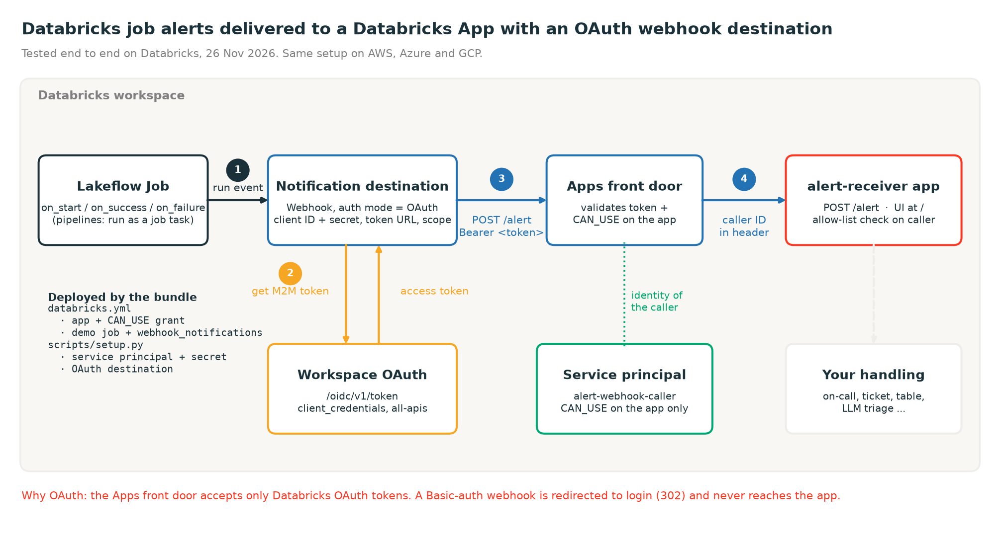

# Receive Databricks job alerts in a Databricks App (OAuth webhook destination)

A Databricks Asset Bundle that delivers job alerts (start, success, failure) to your own Databricks App.
The webhook authenticates with OAuth as a service principal, so it gets through the Apps front door.

Tested end to end on 26 November 2026: the app received `jobs.on_start` and `jobs.on_failure` from a real job run,
and rejected a call from any other identity with 403. The same steps apply on AWS, Azure and GCP.



## Why OAuth

A Databricks App only accepts Databricks OAuth tokens. A webhook destination with HTTP Basic authentication
sends a username and password, so the Apps front door redirects it to login (HTTP 302) and the alert never
reaches your code.

Webhook destinations also support **OAuth 2.0 client credentials**. Databricks fetches an access token from
a token endpoint before every call. Point that at your workspace's own OAuth endpoint, use a service principal's
client ID and secret, and the call arrives as that service principal.

| Webhook auth | What the app sees |
|---|---|
| Basic (username / password) | Nothing. The Apps proxy redirects to login (302). |
| OAuth, service principal with CAN USE on the app | The alert, with `X-Forwarded-Email` = the service principal's application ID |

## How it works

1. A job run starts, succeeds or fails and fires its webhook notification.
2. The notification destination gets an M2M token for the service principal from `https://<workspace-host>/oidc/v1/token`.
3. It posts the alert JSON to `https://<app-url>/alert` with `Authorization: Bearer <token>`.
4. The Apps front door validates the token, checks the service principal has **CAN USE** on the app, and forwards
   the request with the caller's identity in `X-Forwarded-Email`.
5. The app checks that identity against an allow-list and handles the alert.

## What's in the bundle

```
alert-webhook-app-bundle/
├── databricks.yml              # bundle, variables, dev/prod targets
├── resources/
│   ├── app.yml                 # the alert-receiver app + CAN_USE grant for the service principal
│   └── demo_job.yml            # a job that fails on purpose, wired to the destination
├── src/
│   ├── app/app.py              # FastAPI receiver: POST /alert, UI at /, JSON at /api/alerts
│   ├── app/requirements.txt
│   └── demo/fail_on_purpose.py
├── scripts/
│   ├── setup.py                # service principal -> deploy -> OAuth destination -> redeploy
│   └── teardown.py             # removes everything setup.py created
└── docs/
    ├── architecture.png
    └── diagram.py              # regenerates the diagram
```

Notification destinations and service principals aren't bundle resource types, so `scripts/setup.py`
creates those with the Databricks SDK and passes their IDs into the bundle as variables.

## Prerequisites

- A recent Databricks CLI (tested with v1.19.0), authenticated to the target workspace:
  `databricks auth login --host https://<workspace-host> --profile <profile>`
- Python 3.10+ with `pip install "databricks-sdk>=0.40"`
- **Workspace admin** on that workspace (needed to create the service principal and the notification destination)
- Serverless compute enabled (the demo job and the app use it)
- If the workspace has the **compliance security profile** enabled, a workspace admin must first turn on
  **Destination Type Generic Webhook Oauth** on the workspace **Previews** page. Other workspaces don't need this.

## Step by step

### Option A: one command

```bash
python scripts/setup.py --profile <profile>            # add --target prod for the prod target
```

It prints each step and ends with the command to run the demo job. It's safe to re-run: it reuses the
service principal and destination if they already exist.

Then trigger an alert:

```bash
databricks bundle run alert_demo_job -p <profile> \
  --var=caller_sp_application_id=<sp-application-id> --var=alert_destination_id=<destination-id>
```

The run fails on purpose. Open the app URL: `jobs.on_start` appears within seconds and `jobs.on_failure`
appears about two minutes later. Each row links to the run.

### Option B: the same steps by hand

Use this if you'd rather see each moving part, or create the destination in the UI.

**1. Create the service principal.**
Settings > Identity and access > Service principals > Add, name `alert-webhook-caller`. Copy its
**Application ID**. Don't give it any other permissions; it only needs CAN USE on the app.

**2. Deploy the app.**

```bash
databricks bundle deploy -p <profile> --var=caller_sp_application_id=<sp-application-id>
databricks bundle run alert_receiver -p <profile> --var=caller_sp_application_id=<sp-application-id>
```

The first deploy also creates the demo job with a placeholder destination ID (all zeros), because jobs require a UUID there.
Note the app URL from `databricks bundle summary` or the Apps page.

**3. Generate an OAuth secret for the service principal.**
Open the service principal > **Secrets** > Generate secret. Copy the client ID and secret. The secret is shown only once.

**4. Create the OAuth webhook destination.**
Settings > Notifications > Notification destinations > Manage > Add destination:

| Field | Value |
|---|---|
| Name | `alert-receiver-oauth` |
| Type | Webhook |
| Authentication mode | OAuth |
| URL | `https://<app-url>/alert` |
| Client ID / Client secret | from step 3 |
| Token endpoint URL | `https://<workspace-host>/oidc/v1/token` |
| Scopes | `all-apis` |

Press **Test** on the destination; a test event should appear in the app. Copy the destination ID.

**5. Wire the job to it and run.**

```bash
databricks bundle deploy -p <profile> --var=caller_sp_application_id=<sp-application-id> --var=alert_destination_id=<destination-id>
databricks bundle run alert_demo_job -p <profile> --var=caller_sp_application_id=<sp-application-id> --var=alert_destination_id=<destination-id>
```

## The code that makes it work

### 1. The destination authenticates with OAuth, not Basic (`scripts/setup.py`)

```python
secret = w.api_client.do("POST", f"/api/2.0/accounts/servicePrincipals/{sp.id}/credentials/secrets", body={})
dest = w.api_client.do("POST", "/api/2.0/notification-destinations", body={
    "display_name": DESTINATION_NAME,
    "config": {"generic_webhook": {
        "url": f"{app_url}/alert",
        "oauth_client_id": sp.application_id,
        "oauth_client_secret": secret["secret"],
        "oauth_token_url": f"{host}/oidc/v1/token",   # the workspace's own OAuth endpoint
        "oauth_scopes": ["all-apis"],
    }},
})
```

This is the key part. With these four OAuth fields set, Databricks gets a token for the service principal before each call.
You can't combine them with `username` / `password`. The secret goes straight into the destination and is never printed or saved.
The REST call is used because the OAuth fields aren't in every SDK version yet.

### 2. The service principal can use the app, and nothing else (`resources/app.yml`)

```yaml
permissions:
  - service_principal_name: ${var.caller_sp_application_id}
    level: CAN_USE
```

Without CAN USE, the Apps front door rejects the token even though it's valid.

### 3. The job sends its events to the destination (`resources/demo_job.yml`)

```yaml
webhook_notifications:
  on_start:   [{ id: "${var.alert_destination_id}" }]
  on_success: [{ id: "${var.alert_destination_id}" }]
  on_failure: [{ id: "${var.alert_destination_id}" }]
```

Add the same block to your real jobs, or pick the destination under the job's **Notifications** in the UI.
To alert on a pipeline, run it as a pipeline task in a job and put the notification on the job.

### 4. The app accepts alerts only from the expected caller (`src/app/app.py`)

```python
ALLOWED_CALLERS = {c.strip() for c in os.getenv("ALLOWED_ALERT_CALLERS", "").split(",") if c.strip()}

@app.post("/alert")
async def receive_alert(request: Request):
    caller = request.headers.get("x-forwarded-email", "")
    if ALLOWED_CALLERS and caller not in ALLOWED_CALLERS:
        raise HTTPException(status_code=403, detail="caller is not an allowed alert sender")
    payload = await request.json()
    ...
    # >>> Put your alert handling here: route to on-call, open a ticket, write to a table, call an LLM to triage, ...
```

Anyone with CAN USE could otherwise post to `/alert`. The Apps proxy sets `X-Forwarded-Email`, so the app can trust it.
`ALLOWED_ALERT_CALLERS` is set from the bundle (`config.env` in `resources/app.yml`).

### What the job sends

```json
{
  "event_type": "jobs.on_failure",
  "workspace_id": 1234567890123456,
  "run": { "run_id": 987654321098765 },
  "job": { "job_id": 123456789012345, "name": "alert-webhook-demo-job" }
}
```

Event types include `jobs.on_start`, `jobs.on_success` and `jobs.on_failure`. The payload is small, so if your
handling needs task errors or durations, look up the run with the Jobs API using `run_id`.

## Verify it

| Check | Expected |
|---|---|
| Open the app URL | Alerts table, empty before the first run |
| Run the demo job | `jobs.on_start` row in seconds, `jobs.on_failure` about two minutes later, each linking to the run |
| "Sent by" column | The service principal's application ID |
| `curl -X POST https://<app-url>/alert -H "Authorization: Bearer <your user token>"` | 403 `caller is not an allowed alert sender` |
| `curl -X POST https://<app-url>/alert -u user:pass` | 302 (Basic auth never reaches the app) |
| App > **Logs** | One `ALERT {...}` line per alert |

## Things to know before production

- **Storage.** The demo keeps alerts in memory, so they reset when the app restarts. Write them to Lakebase or a Delta table instead.
- **Secret rotation.** The destination holds the service principal's OAuth secret. Rotate it by generating a new secret,
  updating the destination, then deleting the old secret.
- **Networking.** Webhooks are sent from the Databricks control plane. If the app sits behind ingress restrictions
  (private access only, or IP access lists), check that the call is still allowed. Test this in your environment.
- **Compliance security profile.** Turn on the Previews toggle above before creating the destination.
- **Scope.** OAuth is supported on workspace-level destinations, which is what job notifications use.

## Clean up

```bash
python scripts/teardown.py --profile <profile>
```

This destroys the bundle (app and demo job), deletes the destination and deletes the service principal (and its secrets with it).

## References

- [Manage notification destinations](https://docs.databricks.com/gcp/en/admin/workspace-settings/notification-destinations) (OAuth webhook section)
- [Job notifications](https://docs.databricks.com/gcp/en/jobs/notifications)
- [Databricks Apps](https://docs.databricks.com/gcp/en/dev-tools/databricks-apps/)
- [OAuth M2M authentication](https://docs.databricks.com/gcp/en/dev-tools/auth/oauth-m2m)
- [Databricks Asset Bundles: apps](https://docs.databricks.com/gcp/en/dev-tools/bundles/resources#apps)
